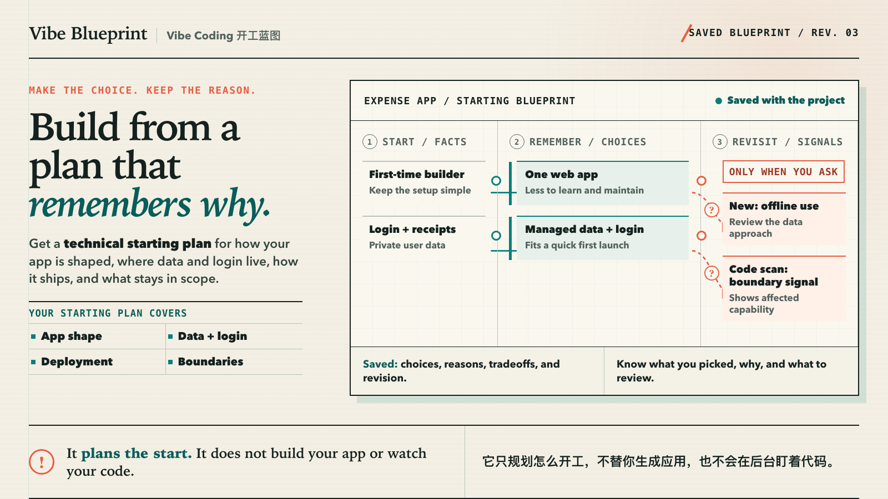

<p align="center">
  
</p>

<h1 align="center">Vibe Blueprint</h1>

<p align="center">
  <strong>Vibe Coding 开工蓝图</strong><br />
  Build from a plan that remembers why.
</p>

<p align="center">
  Get a technical starting plan for your app shape, data and login, deployment, and project boundaries.<br />
  Save the choices and reasons. Revisit them only when you ask.
</p>

<p align="center">
  <a href="#quick-start">Quick start</a> ·
  <a href="#start--remember--revisit">How it works</a> ·
  <a href="#technical-trust">Technical trust</a> ·
  <a href="docs/security.md">Security</a> ·
  <a href="docs/client-configs.md">Client setup</a>
</p>

> [!IMPORTANT]
> **It plans the start. It does not build your app or watch your code.**<br />
> **它只规划怎么开工，不替你生成应用，也不会在后台盯着代码。**

> [!NOTE]
> This project is not yet published to npm. Install it from the public source repository for now.

## Start with the app idea, not the tech vocabulary

You can ask in ordinary language:

> I want to build a small expense reimbursement app. I do not understand tech stacks. Give me a practical starting plan, explain the important choices, and tell me what remains uncertain.

Vibe Blueprint can return a plan shaped like this:

| Part of the blueprint | Example answer |
| --- | --- |
| App shape | Start with one web application instead of several services. |
| Data + login | Keep receipts and accounts in managed server-side storage with managed login. |
| Deployment | Use one managed deployment path for the first launch. |
| Boundaries | Include employee submissions and approvals; exclude payroll and direct money movement; confirm whether offline work is required. |
| Why | Fewer moving parts make the first version easier to build and maintain. |
| Drawback | The managed platform creates a vendor dependency. |
| Review trigger | Revisit the data approach if field staff must work through outages. |

This is an illustration of the deliverable, not a universal recommendation for every expense app.

## Start → Remember → Revisit

### Start

Describe what you want to build and the realities that matter. The configured model extracts facts and proposes complete foundation routes. Code-based gates then reject hard-constraint failures, merge look-alike choices, remove dominated routes, check required minimum safeguards, and either select a route, ask one material question, offer at most two genuinely different business routes, escalate, or abstain.

The result covers the application shape, data and login, deployment, included and excluded capabilities, important assumptions, tradeoffs, and conditions that should trigger another review.

### Remember

After you approve a proposal, Vibe Blueprint saves versioned, Git-friendly project state. Later coding sessions can retrieve the accepted choices and their reasons instead of reconstructing them from chat history.

The machine-readable source of truth remains:

```text
.project-foundation/foundation.json
```

Readable and evidence-oriented artifacts include:

```text
PROJECT-FOUNDATION.md
.project-foundation/session-brief.md
.project-foundation/evidence.json
.project-foundation/decisions.jsonl
```

### Revisit

Review happens only when you or your coding agent requests it:

- a new requirement can trigger focused reassessment of affected capabilities;
- an on-demand Git scan can report combined payment, multi-organization, offline, and sensitive-data signals plus affected capabilities; and
- a registered evidence check can be previewed or run through the command allowlist.

A Git signal does not silently rewrite the saved blueprint, identify every affected decision with semantic certainty, repair code, block a commit, or run continuously in the background.

## Quick start

### Requirements

- Node.js 20 or newer
- npm
- Git for change scanning and commit-aware evidence
- your own key for an OpenAI Responses-compatible endpoint

No API key is bundled, shared, or read from Codex authentication files.

### 1. Install from source

```bash
git clone https://github.com/SinboBoop/vibe-blueprint.git
cd vibe-blueprint
npm ci
npm run build
npm link
```

This exposes:

- `vibe-blueprint-mcp` — the stdio MCP server; stdout is reserved for protocol messages.
- `vibe-blueprint` — secure credential management and local diagnostics.

### 2. Record your key locally

```bash
vibe-blueprint auth set
vibe-blueprint auth status
```

`auth set` accepts no key argument. It reads from an interactive terminal without echo and stores the credential in the platform user-config directory with restrictive permissions where supported. Never paste a key into chat or an MCP client configuration.

### 3. Register the MCP server

First resolve the executable's absolute path:

```bash
command -v vibe-blueprint-mcp
```

For Codex, replace the executable and project-root placeholders with absolute paths:

```bash
codex mcp add vibe_blueprint \
  --env FOUNDATION_ALLOWED_ROOTS=/absolute/path/to/projects \
  --env FOUNDATION_CODE_SHARING=none \
  -- /absolute/path/to/vibe-blueprint-mcp
```

Long model analyses may need the client timeout shown in the complete [Codex, Claude Code, Cursor, and generic stdio configurations](docs/client-configs.md).

### 4. Install the thin Codex Skill

```bash
mkdir -p "${CODEX_HOME:-$HOME/.codex}/skills"
ln -s "/absolute/path/to/vibe-blueprint/skill/vibe-blueprint" \
  "${CODEX_HOME:-$HOME/.codex}/skills/vibe-blueprint"
```

The Skill decides when to invoke Vibe Blueprint and presents the result in plain language. The decision logic stays in the MCP server.

### 5. Check the real model connection

```bash
vibe-blueprint doctor /absolute/path/to/project --check-model
```

Then start a new client session and ask:

> I want to build a small SaaS where agencies manage separate client workspaces and pay monthly. Create a Vibe Blueprint before coding.

For an existing project:

> Field staff must now keep editing during outages. Revisit the saved blueprint before implementation.

For a normal bug, styling change, or isolated feature that does not cross a project-foundation boundary, use the ordinary coding workflow instead.

## Technical trust

### The model proposes; code-based gates check the proposal

Vibe Blueprint is not a prompt-only stack picker. Its configured model authors facts, candidate routes, scores, explanations, and safeguard declarations. Deterministic code validates that structured proposal against the documented Decision Integrity boundary: hard constraints, activity-risk rules, route equivalence and dominance, stable ordering, and minimum-invariant completeness.

Those checks reduce plausible-sounding choices that contradict the stated project realities. They do **not** prove a universally best stack, independently verify a vendor, inspect whether safeguards were implemented correctly, or certify production readiness.

### Saved state does not depend on chat memory

An approved plan is written atomically as schema-versioned project state with readable summaries and an append-only decision record. Pending `analysis_id` values exist only in the running MCP process; restart the server before committing and the pending analysis is discarded, while committed project files remain durable.

### Verification is constrained

Registered evidence commands run with separated arguments, `shell: false`, a controlled working directory, an allowlist, timeouts, output caps, redaction, and package-script hash binding. This is narrower than arbitrary command execution, but a passing check proves only what that registered check actually covers.

### Repository checks

The repository includes automated tests, strict TypeScript checks, linting, protocol integration, installed-shape stdio checks, a checked-in known-regression inventory, and a repository secret scan. The inventory covers maintained failure families; it is not an expert-labelled representative benchmark, a general accuracy score, or evidence of superiority over another model.

Reproduce the checks locally:

```bash
npm ci
npm run lint
npm run typecheck
npm run build
npm test
npm run inventory:report
npm run test:protocol
npm run test:e2e
npm run scan:secrets
npm run check:skill
npm run check:brand
npm run check:package
```

Provider-backed verification is explicit, opt-in, and may consume quota:

```bash
npm run verify:live
```

Its sanitized record is scoped to that run; it is not an SLA or a production-readiness certificate.

## The eight stable MCP tools

The `foundation_*` names below are stable protocol identifiers retained for compatibility; they are not a second public brand.

| Tool | Responsibility |
| --- | --- |
| `foundation_doctor` | Check configuration, credential presence, allowed roots, model connectivity, saved state, and protection coverage. |
| `foundation_analyze_project` | Ask the internal model for facts and candidate routes, then apply activity-risk, invariant, and route checks. |
| `foundation_answer_question` | Apply the user's answer to the returned material-reality question and re-evaluate the recommendation. |
| `foundation_commit` | Atomically write a user-confirmed proposal to project-foundation artifacts without modifying application source. |
| `foundation_get` | Read saved state as JSON, Markdown, or a compact Session Brief. |
| `foundation_assess_change` | Compare a new requirement with committed state and reanalyse affected capabilities. |
| `foundation_scan_changes` | Inspect Git changes, dependencies, migrations, environment names, and structure for combined boundary signals. |
| `foundation_verify` | Preview or run one explicitly registered, allowlisted evidence check without a shell. |

## Security and privacy defaults

- **Your key stays outside the repository.** `vibe-blueprint auth set` uses a user-level credential file; CLI key arguments are rejected.
- **No repository context by default.** `FOUNDATION_CODE_SHARING=none` sends no caller-supplied summary, source, or Git diff.
- **Explicit context ceilings.** `summary` accepts only bounded, redacted structural text; only `diff` permits bounded, redacted added lines.
- **Narrow filesystem access.** Every `project_root` is canonicalized with `realpath` and checked against `FOUNDATION_ALLOWED_ROOTS`, including symbolic-link escapes.
- **Untrusted repository text stays data.** Comments, documentation, summaries, and diffs are isolated from instructions before model analysis.
- **No arbitrary shell runner.** Evidence commands use an allowlist, `shell: false`, timeouts, output caps, redaction, and package-script hash binding.
- **Protocol-safe logging.** stdio stdout carries MCP only; diagnostics go to stderr and redact headers, bearer tokens, and key-shaped strings.
- **No silent model fallback.** The configured model ID is preserved and reported when the provider rejects it.
- **No response-storage request.** Responses requests send `store: false`; the endpoint operator's infrastructure remains outside this project's control.

Read the complete [security model](docs/security.md) and [security reporting policy](SECURITY.md) before sharing repository diffs or sensitive requirements.

## Configuration

The `FOUNDATION_*` environment variables and `.project-foundation/` state names remain stable protocol and persistence contracts.

| Variable | Default | Purpose |
| --- | --- | --- |
| `FOUNDATION_LLM_API_KEY` | none | Highest-priority credential; prefer `vibe-blueprint auth set` on a workstation. |
| `FOUNDATION_LLM_BASE_URL` | `https://api.inferenvoy.com` | Responses-compatible base URL. |
| `FOUNDATION_LLM_RESPONSES_PATH` | discovered | Explicit path override; otherwise `/responses`, then `/v1/responses` only after 404/405. |
| `FOUNDATION_LLM_MODEL` | `gpt-5.6-sol` | Exact model ID; never silently replaced. |
| `FOUNDATION_LLM_REASONING_EFFORT` | `xhigh` | Responses reasoning effort. |
| `FOUNDATION_ALLOWED_ROOTS` | server working directory | Platform-delimited roots under which `project_root` may resolve. |
| `FOUNDATION_CODE_SHARING` | `none` | Maximum repository context: `none`, `summary`, or `diff`. |

Endpoint discovery caches only non-secret endpoint metadata in the user config directory. See [.env.example](.env.example) for placeholders; never put a real credential in a tracked file.

## Supported boundary

Vibe Blueprint is scoped to early Web apps, SaaS products, internal tools, and AI Web projects across five reviewed architecture patterns.

It is **not**:

- a complete application generator;
- a background repository monitor, automatic plan updater, commit blocker, or deployment blocker;
- a guarantee of the best technology stack;
- a universal architecture, vendor, medical, financial, legal, privacy, security, or compliance advisor;
- proof that declared safeguards exist in source code;
- a technology evidence catalog or exact-version freshness service;
- a production-readiness, security, or compliance certificate; or
- an expert-labelled general-quality benchmark.

Change scanning reports conservative signals and affected capabilities, not whole-program semantic proof or a replacement blueprint. Only separately configured hooks, CI checks, and protected branches can turn selected findings into technical blockers.

See the [Decision Integrity release notes](docs/releases/decision-integrity.md) for the exact compatibility contract.

## Compatibility note

Before the public rename, local checkouts used the pre-release executable aliases `foundation-guard` and `foundation-guard-mcp` and stored credentials under a `foundation-guard` user-config directory. This package temporarily keeps those executable aliases and safely reads that credential location when the new one is absent, so existing local users do not need to re-enter a key. New setup should use `vibe-blueprint`, `vibe-blueprint-mcp`, the `vibe_blueprint` client key, and the `skill/vibe-blueprint` path.

The eight `foundation_*` tools, `FOUNDATION_*` settings, `.project-foundation/` directory, `PROJECT-FOUNDATION.md`, and schema version 1 intentionally remain stable.

## Upgrade and removal

Upgrade a source checkout with `git pull --ff-only`, `npm ci`, `npm run build`, `npm test`, and `npm link`. Review the release notes before upgrading a shared project because the Decision Integrity contract adds `abstain` as a fifth successful interaction mode.

Before uninstalling the executable, remove the user credential and MCP registration:

```bash
vibe-blueprint auth delete
codex mcp remove vibe_blueprint
npm unlink --global vibe-blueprint-mcp
```

Uninstalling does not delete `.project-foundation/` or `PROJECT-FOUNDATION.md` from projects; those are project records and must be reviewed separately.

## Contributing and security

Issues and pull requests are welcome. Do not put keys, private source, raw diffs, exploit details, or unredacted logs in a public issue. Follow [SECURITY.md](SECURITY.md) to report vulnerabilities privately through GitHub.

## License

[MIT](LICENSE)
